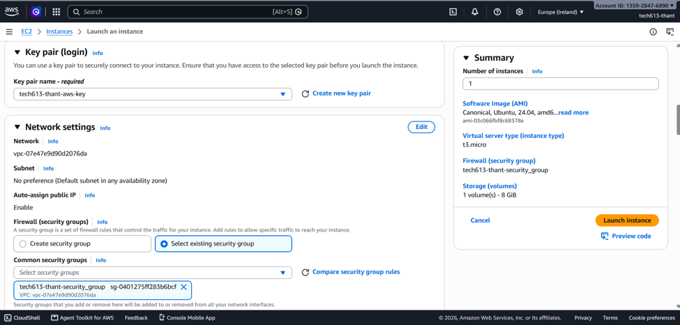
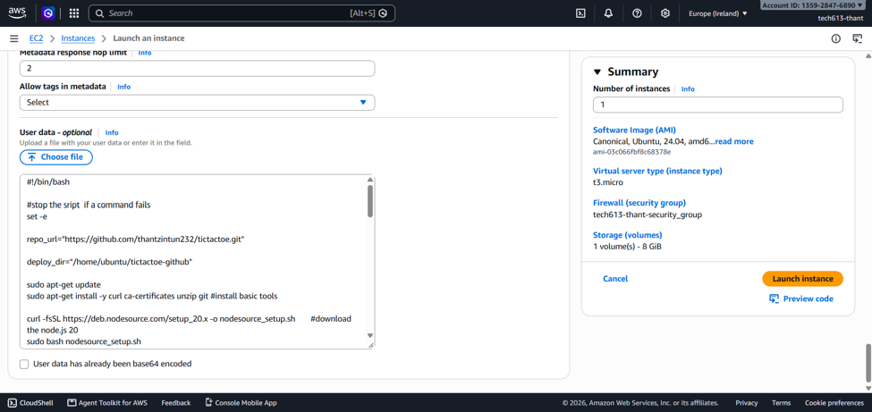
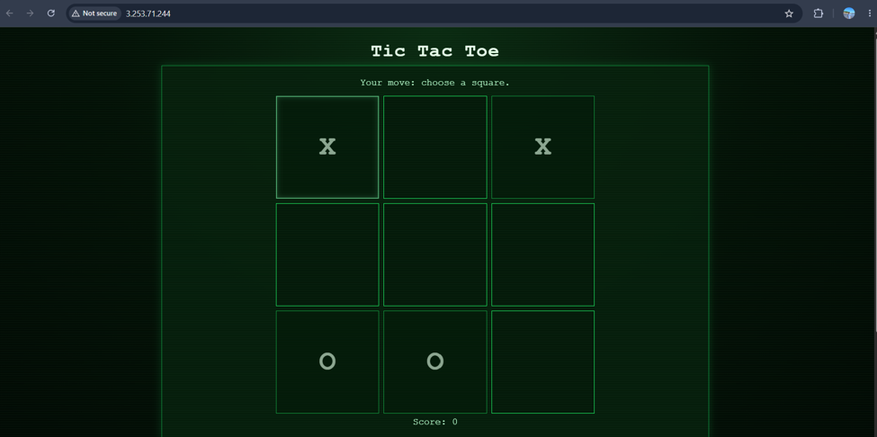

# Deploying Tic-Tac-Toe (Node.js app) using user data on AWS EC2

This project deploys a Node.js tic-tac-toe app using a Bash provisioning script. The script downloads the source code from GitHub, installs dependencies, starts the app with PM2 and configures Nginx as a reverse proxy.

The app was also deployed on a new EC2 instance using User Data, without connecting through SSH.

## Requirements

- An AWS account with permission to launch EC2 instances.
- Ubuntu Server 24.04 LTS, using the x86 architecture.
- A t3.micro instance for this exercise.
- A public subnet with internet access and an assigned public IPv4 address.
- Access to this public GitHub repository:
  https://github.com/thantzintun232/tictactoe

AWS resources may incur charges.

## Repository contents

- `app/` — Node.js application source code and dependency files.
- `provision-app.sh` — automated deployment script.
- `screenshots/` — screenshots showing the deployment stages.
- `README.md` — deployment instructions.

## What the script does

1. Refreshes Ubuntu's package list and installs the required tools.
2. Installs Node.js and npm.
3. Clones the GitHub repository, or pulls updates if it already exists.
4. Installs application dependencies using `npm ci --ignore-scripts`.
5. Starts the app as the `ubuntu` user through PM2.
6. Configures PM2 to restore the app after a reboot.
7. Installs and configures Nginx.
8. Checks the Nginx configuration and restarts the service.

The app is downloaded to:

`/home/ubuntu/tictactoe-github`

The script currently selects Node.js 20 to match the course application. This records the version used for the exercise; review runtime support before using the project in production.

## Deploy using EC2 User Data

### 1. Launch a new instance

In the AWS console, open EC2 and select **Launch instance**.
Choose:

| Setting | Value |
|---|---|
| Name | `tech613-thant-tictactoe-user-data` |
| Operating system | Ubuntu Server 24.04 LTS |
| Architecture | 64-bit x86 |
| Instance type | t3.micro |
| Key pair | An existing key pair, if required |

No SSH connection is needed to perform this deployment.

### 2. Configure networking

Enable automatic assignment of a public IPv4 address.

Configure the security group:

| Type | Port | Source | Purpose |
|---|---|---|---|
| HTTP | 80 | `0.0.0.0/0` | Browser access to the app |
| SSH, optional | 22 | My IP | Troubleshooting access |

*Note: In this case, just selected the existing secruity group*



### 3. Add the User Data script

Open **Advanced details** and find **User data**.

Copy the complete contents of `provision-app.sh` into the field, including the first line: 



Leave the base64-encoded option unchecked when pasting plain text.

### 4. Launch and wait

Select **Launch instance**.

Wait until the instance shows **Running**, then allow several more minutes for the script to finish installing software. (approx: 5 mins waiting time)

### 5. Open the application

Copy the new instance's public IPv4 address.

Open the following in a browser, replacing the placeholder:
```text
http://YOUR-NEW-PUBLIC-IP
```
Use HTTP, not HTTPS. Do not add `:3000`.

The tic-tac-toe app should appear. Play a game to check that it responds.



## Cleanup

When finished with the exercise, stop or terminate instances that are no longer needed.

Stopping an instance does not remove all associated costs, such as storage. Termination can delete its root disk, so save required work first.