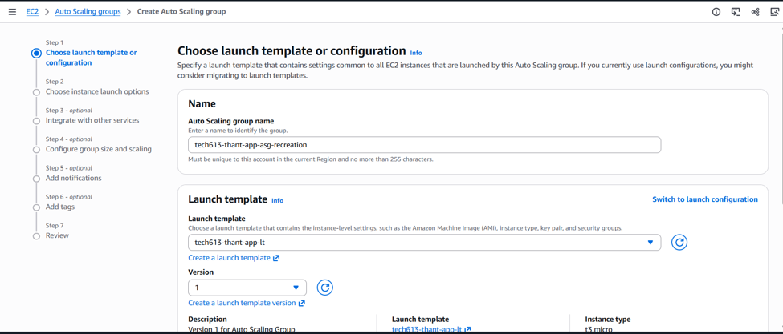
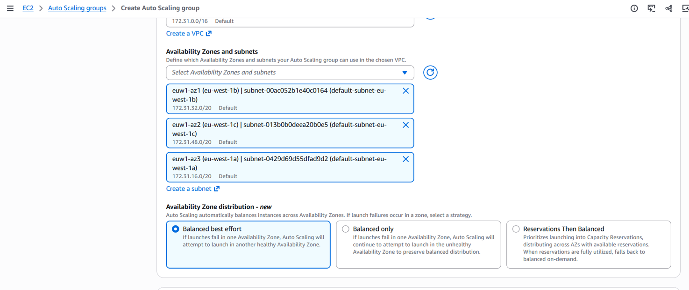
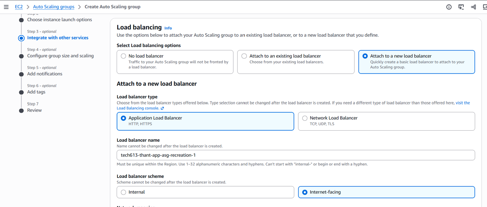
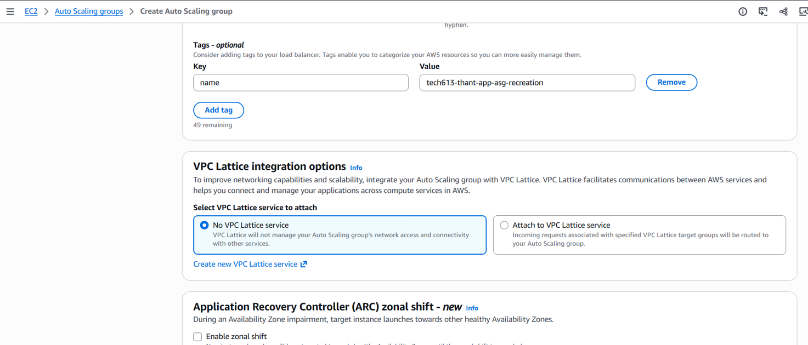
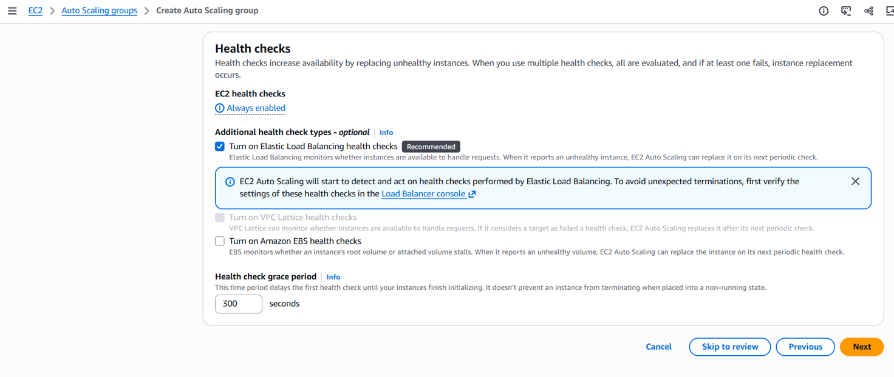
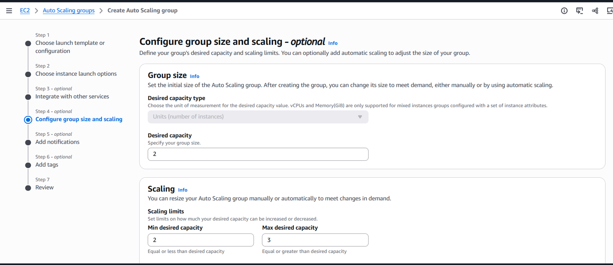
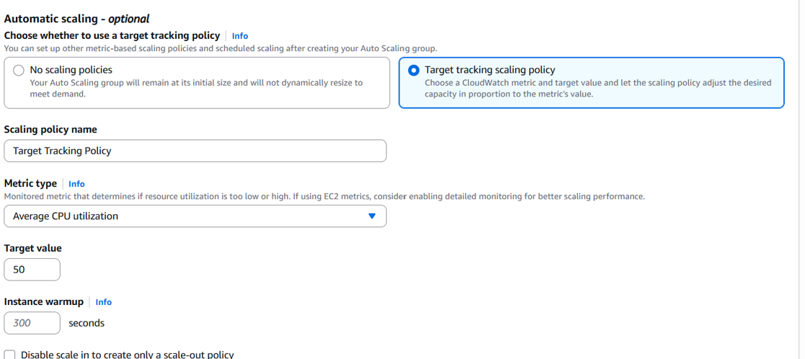
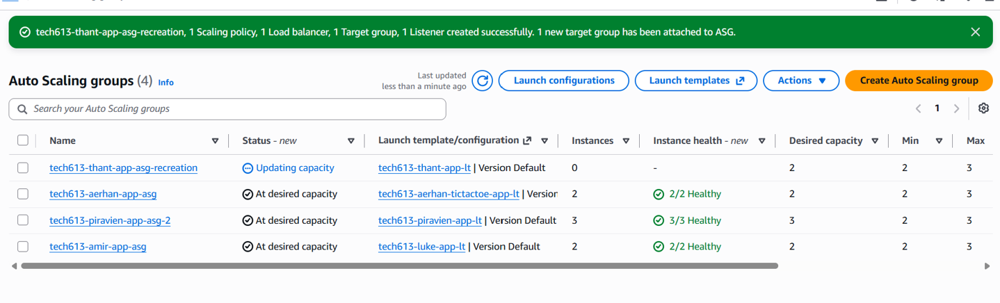
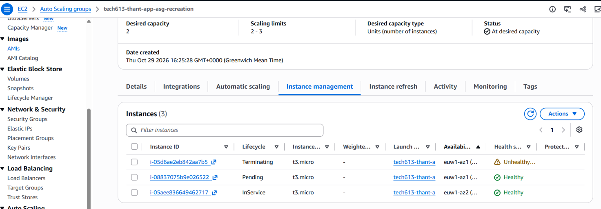

# AWS Auto Scaling

## What is Auto Scaling?

Auto Scaling automatically adds or removes EC2 instances as demand changes. It helps maintain performance and availability while reducing unnecessary costs. An Auto Scaling Group (ASG) also replaces unhealthy instances.

## Two types of scaling

| Type | What it does | Why use it? |
|---|---|---|
| Vertical scaling (up/down) | Changes a server's CPU and memory, usually by changing its instance type. | Useful when an application needs a more powerful server; changing instance type usually requires downtime. |
| Horizontal scaling (out/in) | Adds or removes servers. | Useful for handling changing traffic and improving availability across multiple servers. EC2 Auto Scaling uses this approach. |

## 1. Create a launch template

- Select the working app AMI and `t3.micro` instance type.
- Choose the existing key pair and app Security Group.
- Ensure Nginx and the app start automatically on boot, using the AMI configuration or User Data.

## 2. Create an Auto Scaling Group

- Open **EC2 → Auto Scaling Groups → Create Auto Scaling group**.
- Name the group and select the launch template.

## 3. Choose instance launch options

- Confirm the correct VPC.
- Select suitable subnets across the three Availability Zones in `eu-west-1`. For this setup, use public subnets.
- Keep the remaining settings at their defaults.

## 4. Configure load balancing and health checks

- Select **Attach to a new load balancer → Application Load Balancer**.
- Name it and choose **Internet-facing**.
- Select public subnets in at least two Availability Zones, covering the zones used by the ASG.
- Use an **HTTP listener on port 80**.
- Enable **Elastic Load Balancing health checks** and set the grace period to **300 seconds**.

The ASG automatically registers new instances with the target group. The load balancer sends traffic to healthy instances.

## 5. Configure group size and automatic scaling

| Setting | Value | Meaning |
|---|---:|---|
| Desired capacity | 2 | Start with two app instances |
| Minimum capacity | 2 | Keep at least two running |
| Maximum capacity | 3 | Allow one extra instance when needed |

Set the scaling policy:

- **Policy:** Target tracking
- **Metric:** Average CPU utilization
- **Target:** 50%
- **Instance warmup:** 300 seconds
- Leave **Disable scale in** unticked.

## 6. Notifications and tags

- Skip notifications.
- Add a `Name` tag, such as `thant-tictactoe-asg-instance`.
- Enable **Tag new instances**, review the settings and create the group.

## 7. Verify and test

- Check **Activity** for successful launches and **Instance management** for two `InService` instances.
- Confirm the target group reports healthy targets.
- Open the load balancer's DNS name using `http://` and check the app loads.

**Replacement test:** I terminated one instance in the ASG. AWS launched a replacement to restore the desired capacity, and the new instance became healthy. This demonstrated automatic replacement, rather than CPU-based scaling.

To test demand-based scaling separately, generate sustained CPU load across the app instances and monitor the scaling policy and ASG activity. After the load stops, the group can return to its minimum of two instances.

## Reference

[AWS: Set up a scaled and load-balanced application](https://docs.aws.amazon.com/autoscaling/ec2/userguide/tutorial-ec2-auto-scaling-load-balancer.html)
