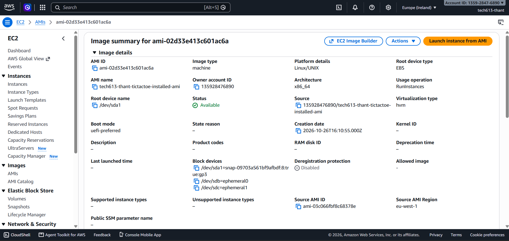

# Creating AMI and userdata Documentation

Automation: Create an AMI and connect with user data.

## AMI Deployment Documentation

### 1. Launch an EC2 instance

Created an Ubuntu instance named with something "app-ami-source", selected an existing SSH key pair, and allowed:

- **SSH (22):** My IP
- **HTTP (80):** Anywhere IPv4

### 2. Connect through SSH

```
ssh -i "your-key.pem" ubuntu@your-instance-public-dns
```

### 3. Deploy the application

Created the deployment script:

```
nano prov-app-rp.sh
```

Pasted the provided script:
[prov-app-rp.sh](prov-app-rp.sh)

```
bash prov-app-rp.sh
```

The script installed Nginx, Node.js and PM2, cloned the app, installed dependencies, and started it. Nginx forwarded HTTP requests to port `3000`.

### 4. Verify the app

Opened `http://public_ip` and configured the application worked.


### 5. Create the AMI

Selected the instance → Stop → **Actions → Image and templates → Create image**.
- name: "app-ami"
- Kept storage settings unchanged.
- Clicked **Create image**.


**Evidence:** Screenshot of the AMI; wait until its status becomes **Available**.


### 6. Launch a new instance from the AMI

Opened **EC2 → AMIs**, selected the created AMI with status **Available**, and clicked **Launch instance from AMI**.

- Named the instance with "app-ami-userdata", selected an existing key pair.

### 7. Add the user data script

Under **Advanced details → User data**, entered:

```
#!/bin/bash
set -e

systemctl start nginx

cd /home/ubuntu/repo/app
sudo -H -u ubuntu pm2 start index.js --name tic
```

This script starts Nginx and the application as the `ubuntu` user. No software installation is required because the AMI already contains the application and its dependencies.

### 8. Launch and verify

Clicked **Launch instance** and allowed time for startup. Opened:

```
http://NEW_INSTANCE_PUBLIC_IP
```

The application loaded successfully without manually starting it through SSH, confirming that the AMI and user data deployment worked.


### 9. Configure automatic startup

Connected to `app-ami-userdata` through SSH and confirmed the app was running. Ran:

```
pm2 startup
```

Copied and ran the generated `sudo` command, then executed:

```
pm2 save
sudo systemctl enable nginx
```

This configured PM2 to restore the application and Nginx to start automatically at boot.

### 10. Test after reboot

Rebooted the instance:

```
sudo reboot
```

The application loaded successfully without manually starting it, confirming automatic startup worked.

### 11. Create the new AMI

Selected the configured instance → **Actions → Stop → Image and templates → Create image**.

Named it `app-autostart-ami`, and created the image.

### 12. Verify deployment without user data

Launch a new instance named `tictactoe-no-userdata` from this AMI. Enable a public IP, allow HTTP on port **80**, and leave **User data empty**.

Open the new instance’s public IP to verify the app starts automatically.

