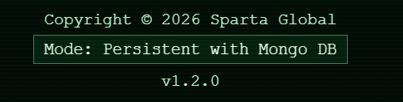

# MongoDB Deployment on AWS

MongoDB runs on a separate EC2 instance connected to the tic-tac-toe app, with setup automated through a Bash script, user data and an AMI.

## 1. Set up the database
- Created a database instance and ran `deploy-db.sh` to install MongoDB 7.0.22.
- The script sets `bindIp` to `0.0.0.0` in `/etc/mongod.conf`, then starts MongoDB and enables it at boot:
  ```
  sudo systemctl start mongod
  sudo systemctl enable mongod
  ```
- Inbound port 27017 is restricted to the app instance's security group.

## 2. Connect the app and seed the database
- Set the database address in the app deployment script:
  ```
  export MONGODB_URI="mongodb://DB-PRIVATE-IP:27017/tictactoe"
  ```
- From `/home/ubuntu/repo/app`, the script ran:
  ```
  pm2 kill
  npm install
  pm2 start index.js --name tic
  pm2 save
  ```

## 3. Install MongoDB via user data
- Launched a new instance, `mongodb-userdata`, with the database script in **Advanced details → User data**.
- Connected and verified over SSH:
  ```
  systemctl status mongod
  ```
- Results: `Running`

## 4. Create an AMI with automatic startup
- Rebooted the database instance; MongoDB started without manual commands.
- Created `mongodb-autostart-ami`, then launched `mongodb-no-userdata` from it with user data empty.
- Connected and verified over SSH:
  ```
  systemctl is-enabled mongod
  systemctl status mongod
  ```
- Results: `enabled`, `running`,

## 5. Point the app to the new database
- Updated the connection on the app instance:
  ```
  export MONGODB_URI="mongodb://NEW-DB-PRIVATE-IP:27017/tictactoe"
  pm2 restart tic --update-env
  pm2 save
  ```
- App showed Persistent with Mongo DB mode and successful scoreboard requests.


## Restarting the setup
- Start both EC2 instances, database first, then the app. MongoDB, PM2 and Nginx start automatically at boot.
