# Monitoring on AWS

In this lab, I used CloudWatch to monitor my application, tested it with ApacheBench, and received a CPU alert in my Sparta Outlook inbox.

## 1 Why we need monitoring

Monitoring helps us check whether an application is running properly. CloudWatch shows CPU usage and network activity, helping us spot problems and understand when a server is busy.

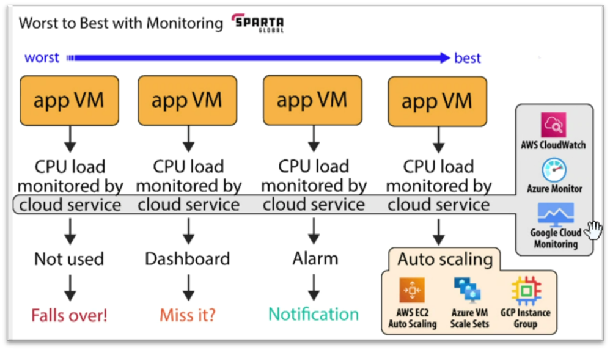

The diagram shows how we can use monitoring, from worst to best:

- **Not used:** Nobody checks the data, so problems can go unnoticed.
- **Dashboard:** We can see problems, but someone needs to watch the graphs.
- **Alarm:** We get a notification when a limit is reached.
- **Auto scaling:** A configured policy adds servers automatically when demand increases.


## 2 Create a dashboard

To create a new one:

1. Go to **EC2 → Instances** and select the application instance.
2. Open **Monitoring**.
3. Open a graph's menu and choose **Add to dashboard**.
4. Create a dashboard, give it a name, and save it.
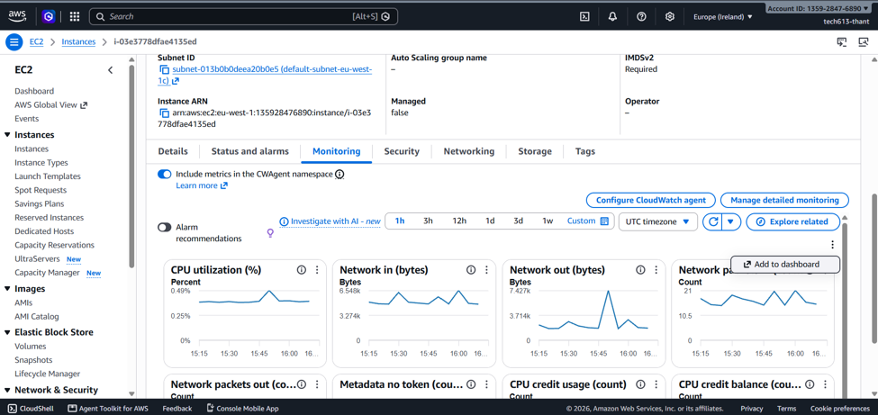
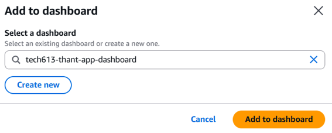


## 3 Test the application with ApacheBench

Install ApacheBench on Ubuntu:

```
sudo apt update
sudo apt install apache2-utils -y
```

Run this against your own lab application, replacing the address:

```
ab -n 5000 -c 100 http://YOUR-APP-ADDRESS/
```
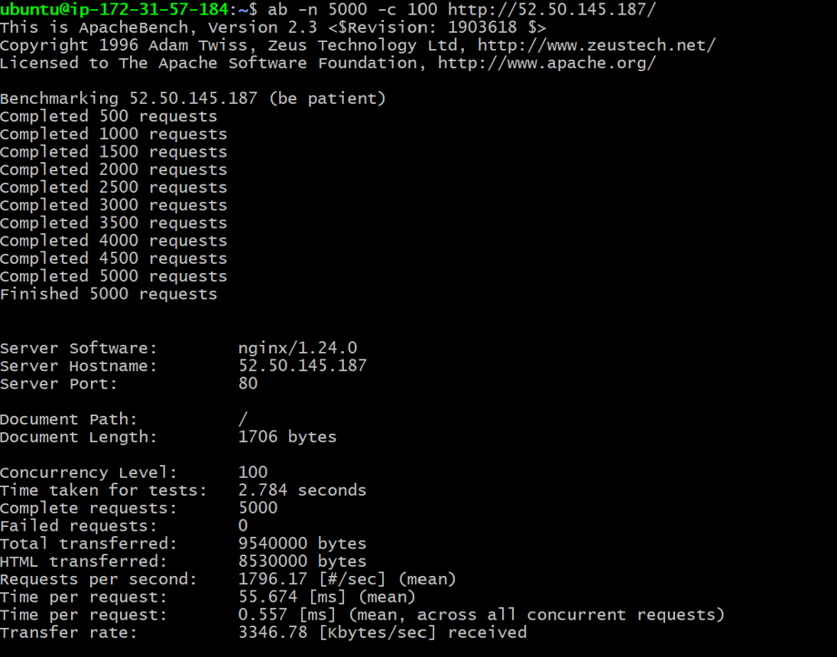
This sends **5,000 requests**, with up to **100 requests at once**.

The first test finished in **2.784 seconds**, with no failed requests. It produced a short CPU spike, but a short spike may not trigger an alarm that requires several minutes of high usage.
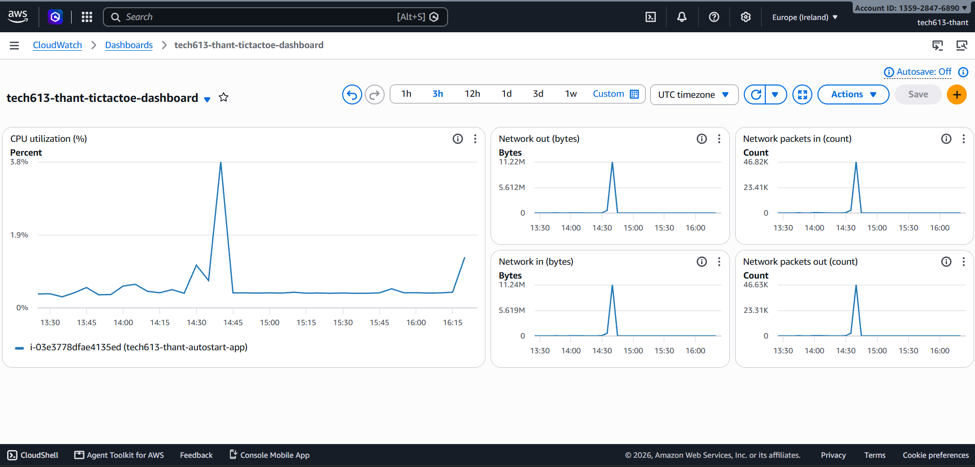

## 4 Set up a CPU alarm

### Enable detailed monitoring

Detailed monitoring provides CPU readings every **one minute** instead of five minutes. It has an additional charge.

1. Select the instance in EC2.
2. Choose **Actions → Monitor and troubleshoot → Manage detailed monitoring**.
3. Tick **Enable** and confirm.

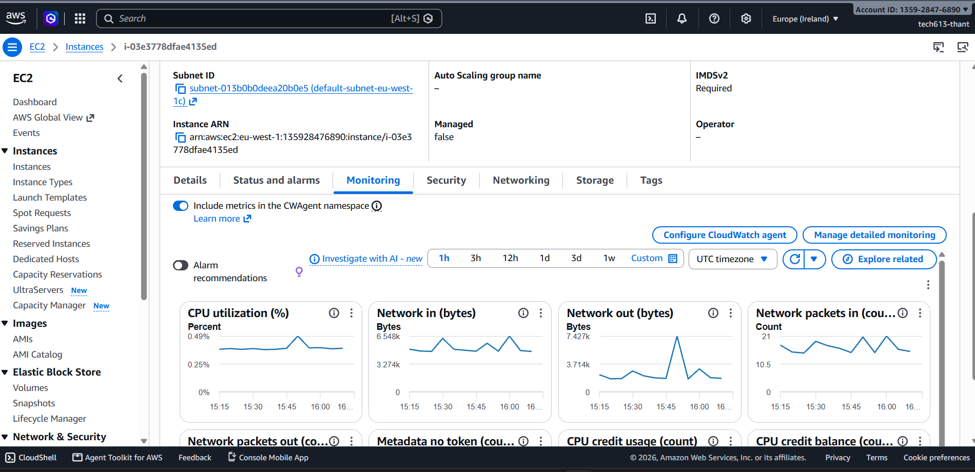
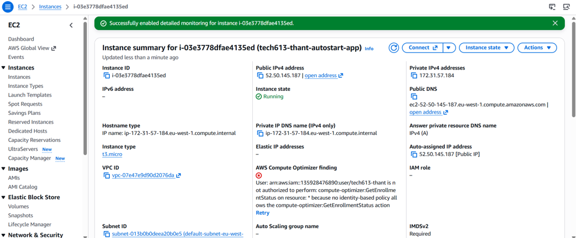
### Choose the metric and conditions

1. Open CloudWatch in the same region as the instance.
2. Go to **Alarms → All alarms → Create alarm**.
3. Choose **Select metric → EC2 → Per-Instance Metrics**.
4. Select **CPUUtilization** for the correct instance.

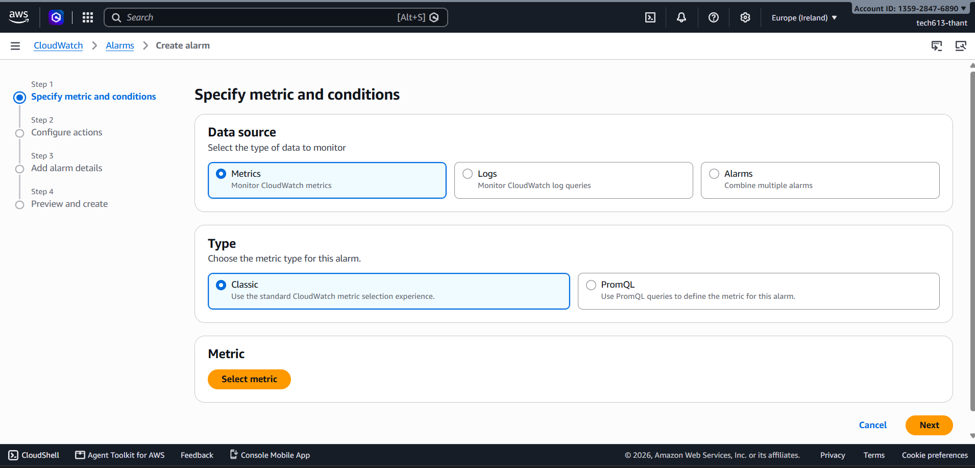

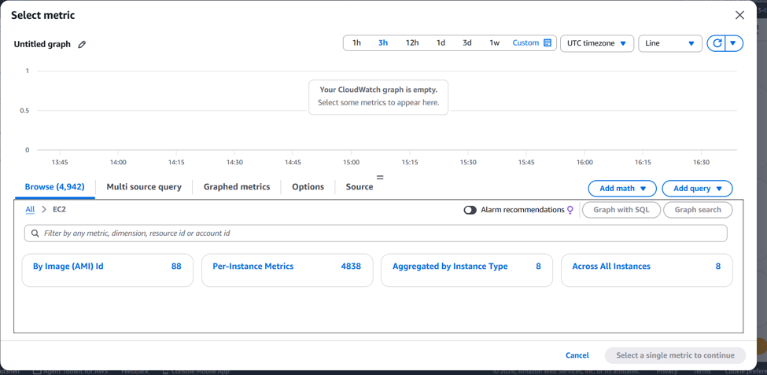

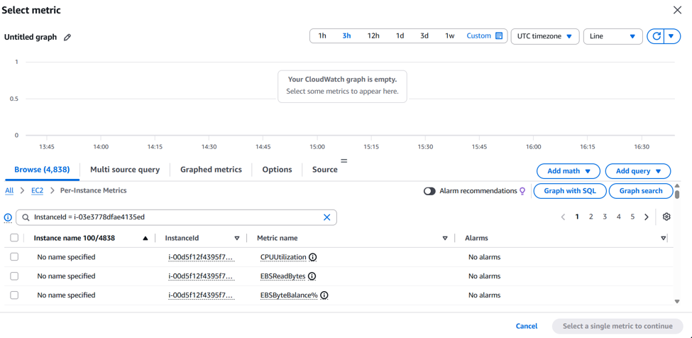

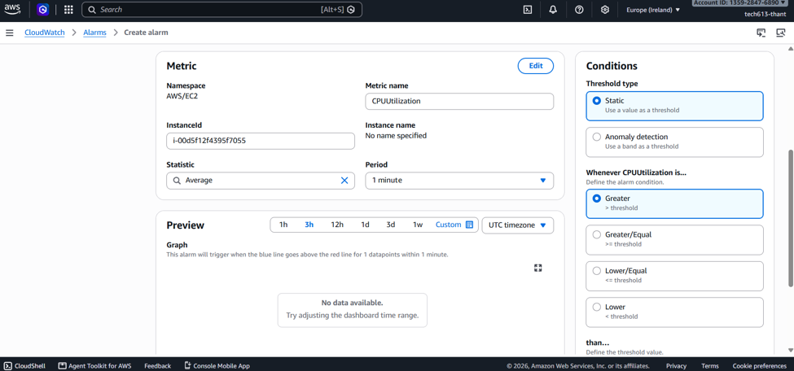

My successful test used these settings:

| Setting | Value |
|---|---|
| Statistic | Average |
| Period | 1 minute |
| Threshold | Greater than 50% |
| Datapoints to alarm | 1 out of 1 |
| Missing data | Treat as missing |

This triggers when **one one-minute CPU average exceeds 50%**.

### Add the email notification

1. Click **Next** and select **In alarm**.
2. Create an SNS topic, such as `cpu-alerts`, with your Sparta Outlook address, or select an existing topic subscribed to that address.
3. Name the alarm and check that its description matches the conditions.
4. Review the settings and click **Create alarm**.
5. Open Outlook and click **Confirm subscription** in the AWS confirmation email.

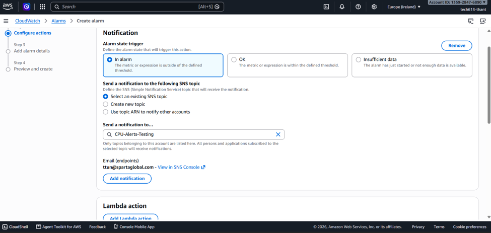

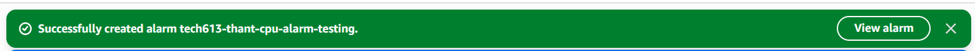
## 5 Test the alarm and check the email

I increased the load with:

```
ab -n 200000 -c 300 http://YOUR-APP-ADDRESS/
```
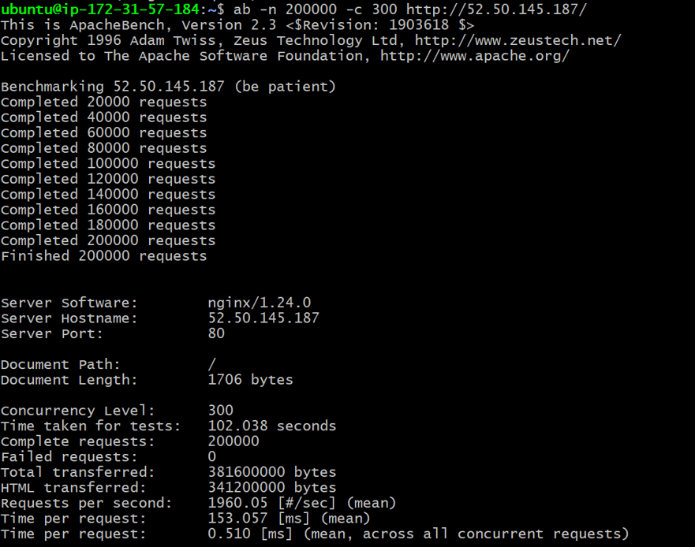

This run completed **200,000 requests in 102.038 seconds**, with no failed requests.

The alarm states mean:

- **Insufficient data:** Not enough readings to evaluate the rule.
- **OK:** The alarm condition has not been met.
- **ALARM:** The condition has been met.

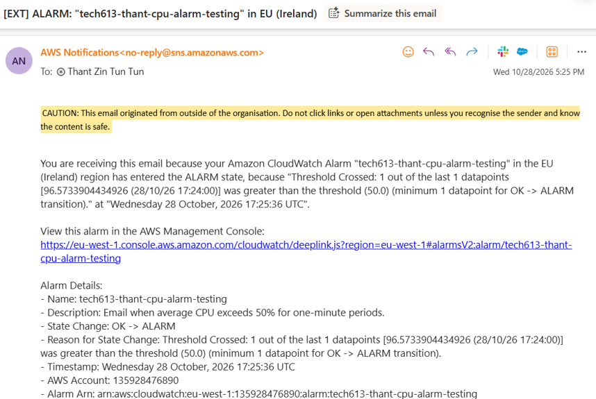
The received email confirms **OK → ALARM** after a CPU reading of about **96.57%**, above the **50%** threshold. This confirms the alarm and email notification worked.

## References

- [AWS CPU alarm guide](https://docs.aws.amazon.com/AmazonCloudWatch/latest/monitoring/US_AlarmAtThresholdEC2.html)
- [AWS detailed monitoring](https://docs.aws.amazon.com/AWSEC2/latest/UserGuide/manage-detailed-monitoring.html)
- [SNS email confirmation](https://docs.aws.amazon.com/sns/latest/dg/sns-email-notifications.html)
- [ApacheBench commands](https://httpd.apache.org/docs/current/en/programs/ab.html)
